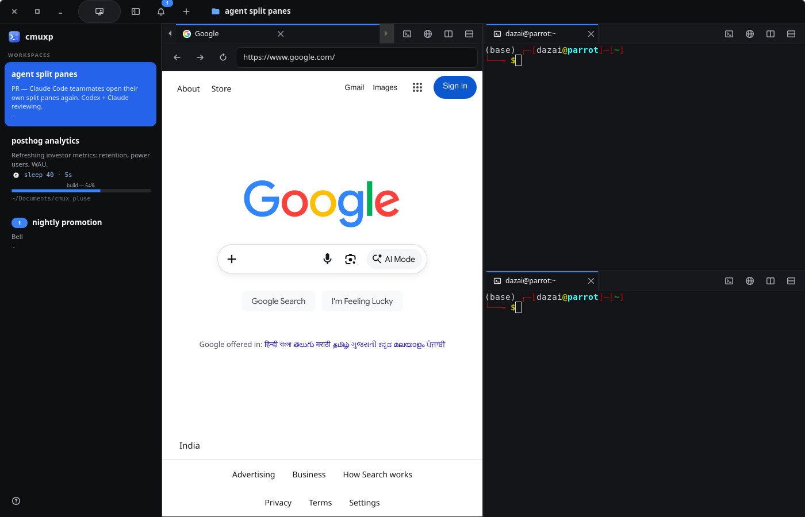

# cmux4linux

A Linux-native terminal for running many coding agents side by side, inspired by
[cmux](https://cmux.com). Rust + GTK4 + VTE, with a built-in WebKitGTK browser.

cmuxp combines terminals, workspaces, split panes, tabs, a built-in browser, and isolated per-workspace networking into one development environment.



- **cmux-style title bar**: sidebar toggle, notification bell with unread badge, new-workspace button, current workspace name
- **Vertical tabs**: one sidebar row per workspace with its name, status, running commands, progress bar, unread badge and `branch • ~/path`
- **Split panes with tab bars**: every pane has its own tabs (terminals and browsers)
- **Drag tabs anywhere**: onto a tab bar or the middle of a pane to join it, onto a pane's edge to split it, or outside the window to float it in its own window
- **Notification center**: the bell lists recent notifications; click one to jump to its tab
- **Search everything** (Ctrl+Shift+Space, or 🔍 in the title bar): one fuzzy search over project **files**, **commands**, **tabs**, your **shell history** and **commits**, with filter chips (Tab to switch)
- **Git history panel** (Ctrl+Shift+G, or the git icon in any tab bar): branch, uncommitted changes, and a commit timeline with branches/tags. Expand a commit for its message, files (+/−), diff, hash, and web link
- **Command palette** (Ctrl+Shift+P): the same popup, filtered to commands
- **Session restore**: reopen with the same workspaces, splits, tabs, folders and browser pages
- **Find in scrollback** (Ctrl+Shift+F): smart-case text or regex, in terminals and browser tabs
- **Ctrl+click** `src/main.rs:42:7` in any output to open it in your editor at that line; Ctrl+click URLs to open them in the browser
- **Git in the sidebar**: `main* ↑1 ↓2` and a clickable **PR #123** for the branch (with the `gh` CLI)
- **Your own shortcuts**: rebind anything, or make keys that run a command, type text, open a URL or open a folder (e.g. Ctrl+Alt+G → `git status`)
- **Background tasks**: when `cargo build` / `npm test` / an agent finishes in a workspace you're not looking at, you get a badge, a blue ring and a desktop notification
- **Built-in browser**: Google search, `localhost:3000` previews, favicons, dev tools (right-click → Inspect)
- **Scriptable**: `cmuxpctl` talks to the app over a Unix socket; each tab knows its own id

Docs: [Architecture](docs/ARCHITECTURE.md) · [System design](docs/SYSTEM_DESIGN.md) · [Requirements](docs/REQUIREMENTS.md) · [Learning path](docs/LEARNING.md)

## Build and run

```bash
sudo apt install build-essential pkg-config libgtk-4-dev libvte-2.91-gtk4-dev libwebkitgtk-6.0-dev
cargo run --release -p cmuxp-app           # use --release day to day; debug builds are much slower

# without the browser (no WebKitGTK needed)
cargo run --release -p cmuxp-app --no-default-features
```

Install for your user (binaries, logo, launcher entry):
```bash
./scripts/install.sh
```

## Shortcuts

| Keys | Action |
|---|---|
| **Ctrl+Shift+Space** | Search everything (files, commands, tabs, history, commits) |
| **Ctrl+Shift+P** | Command palette |
| **Ctrl+Shift+G** | Git history panel |
| **Ctrl+Shift+F** | Find in scrollback / on the page |
| **Ctrl+click** a path or URL | Open it (editor at that line / browser) |
| Ctrl+Shift+N, or **+** in the title bar | New workspace |
| Ctrl+Shift+S, or the sidebar icon | Show / hide the sidebar |
| Ctrl+Shift+I, or the bell | Notification center |
| **Ctrl+,** or **Ctrl+?**, or the keyboard icon in the title bar | Keyboard Shortcuts window |
| Ctrl+Shift+T, or the terminal icon in a tab bar | New terminal tab |
| Ctrl+Shift+B, or the globe icon | New browser tab (Google) |
| Ctrl+Shift+Alt+B | Browser in a split to the right |
| Ctrl+Shift+D / E, or the split icons | Split right / down |
| Ctrl+Shift+W, or **×** on a tab | Close tab (the last tab closes the pane) |
| Ctrl+Tab / Ctrl+Shift+Tab | Next / previous tab |
| Ctrl+Shift+] | Next pane |
| Ctrl+PgDn / PgUp, Alt+1..9 | Switch workspace |
| Ctrl+Shift+U | Jump to a tab with a notification |
| Ctrl+Shift+C / V | Copy / paste |

These are the defaults. Change any of them in **Keyboard Shortcuts** (the **?** at the bottom of the sidebar, or Ctrl+,).

## Your own shortcuts

Open **Keyboard Shortcuts**: **Ctrl+,** (or Ctrl+?), the keyboard icon in the title bar, or **?** in the sidebar.

- Browse by category on the left, or search by name, description or key ("ctrl+d").
- **Click any shortcut** and press the new keys. Held modifiers appear as you press them.
  If the keys are taken you'll see by what, and saving moves them.
  Enter saves, Esc cancels, and "Remove this shortcut" disables it. Changed shortcuts get a *Changed* badge and a reset button.
- **New shortcut**: name it, pick what it does from the cards, type the command/URL/folder and record its keys.
  While you have none, three one-click starters are offered (Git status, Claude in a new tab, localhost:3000).
- Everything saves instantly (a toast confirms it). **Reset all to defaults** asks for a second click first.

What a custom shortcut can do:

| Does | Example |
|---|---|
| Run a command in the current terminal | Ctrl+Alt+G → `git status` |
| Run a command in a new tab | Ctrl+Alt+C → `claude` |
| Type text (no Enter) | Ctrl+Alt+M → `git commit -m "` |
| Open a URL in the browser | Ctrl+Alt+L → `localhost:3000` |
| Open a folder as a new workspace | Ctrl+Alt+A → `~/code/api` |

Everything is saved in `~/.config/cmuxp/shortcuts.toml`. You can edit that file directly; changes apply as soon as you save:
```toml
[bindings]                       # only what you changed; [] disables
split-right = ["ctrl+shift+d", "alt+backslash"]
close-tab = []

[[custom]]
name = "Git status"
keys = ["ctrl+alt+g"]
action = "run"                   # run | run-in-new-tab | type | browser | workspace
value = "git status"
```
Plain keys and Shift+key are refused, so a shortcut can never break normal typing (F1–F12 are allowed alone).

**Dragging tabs:** drop on a tab bar or the middle of a pane to join it. Drop on the outer edge of a
pane to split it on that side (a blue preview shows where). Drop outside the window
to open it in its own window.

## CLI

```bash
cmuxpctl list                                # everything, as JSON
cmuxpctl new --title api --cwd ~/code/api
cmuxpctl rename "agent split panes"
cmuxpctl split right
cmuxpctl tab                                 # new terminal tab in this pane
cmuxpctl browser localhost:3000              # browser tab in this pane
cmuxpctl browser "rust gtk4" --split right   # Google search in a split
cmuxpctl move 8 --zone left                  # move this tab to pane 8, splitting it
cmuxpctl float                               # pop this tab into its own window
cmuxpctl close                               # close this tab
cmuxpctl notify -t "Claude Code" -b "Waiting for input"
cmuxpctl status "Refreshing metrics: retention, WAU"
cmuxpctl progress 64 --label build           # progress bar in the sidebar; "clear" hides it
cmuxpctl send 'npm test\n'
cmuxpctl shortcuts                           # all shortcuts as JSON
cmuxpctl shortcuts --open --section yours    # open the window at a category
cmuxpctl shortcuts --new                     # open the "new shortcut" editor
cmuxpctl shortcuts --change split-right      # record new keys for one action
cmuxpctl action split-right                  # run any action or custom-N by name
cmuxpctl sidebar                             # show/hide the sidebar
cmuxpctl sandbox off                         # this workspace's network sandbox: on | off | toggle
cmuxpctl notifications                       # notification history as JSON (--clear to empty it)
cmuxpctl search main.rs --mode files         # open the search popup pre-filled
cmuxpctl git --commit a1b2c3d                # git panel, expanded at a commit
cmuxpctl find "error"                         # open the find bar and search
cmuxpctl open src/main.rs:42                 # open a file at a line in your editor
cmuxpctl screenshot shot.png
cmuxpctl raw '{"cmd":"ping"}'
```
Inside cmuxp, `--surface` defaults to the tab the command runs in.

## Per-workspace network sandbox

Every workspace runs its terminals inside its own Linux user + network
namespace, so identical `localhost` ports coexist — run `python3 -m http.server
3000` in three workspaces and none collide. It is **rootless**: no Docker, no
sudo, no container runtime. Terminals still run as your normal user.

The in-app browser (which stays in the host namespace) can still preview the
focused workspace: while a workspace is focused, its listening TCP ports are
mirrored onto host `127.0.0.1:<port>` and relayed into the workspace through its
keeper. So `cmuxpctl browser localhost:3000` loads that workspace's dev server.
Only the focused workspace's ports are mirrored at a time.

Turn it off for a workspace with `cmuxpctl sandbox off` (or the
`toggle-network-sandbox` action) to put its shells back in the host namespace.

**Ubuntu (23.10+, default from 24.04):** Ubuntu's AppArmor policy moves any
*unconfined* process that creates a user namespace into a profile that denies
`CAP_NET_ADMIN`, so the sandbox can't bring loopback up and quietly disables
itself. Fix it once with either:

```bash
# a named profile just for cmuxp (recommended; `scripts/install.sh` does this)
sudo install -Dm644 data/cmuxp.apparmor /etc/apparmor.d/cmuxp
sudo apparmor_parser -r /etc/apparmor.d/cmuxp

# or turn the restriction off system-wide
sudo sysctl -w kernel.apparmor_restrict_unprivileged_userns=0
```

## Claude Code integration

`~/.claude/settings.json`:
```json
{
  "hooks": {
    "Notification": [
      { "hooks": [{ "type": "command", "command": "cmuxpctl notify -t 'Claude Code' -b 'Needs your input' 2>/dev/null || true" }] }
    ],
    "Stop": [
      { "hooks": [{ "type": "command", "command": "cmuxpctl notify -t 'Claude Code' -b 'Finished' 2>/dev/null || true" }] }
    ]
  }
}
```
You don't need hooks for plain commands: cmuxp notices on its own when a command
that ran 3 s or longer finishes.

## Editor for Ctrl+click

cmuxp picks the first of these that exists:
1. `CMUXP_EDITOR`, a command with `{file}`, `{line}`, `{col}`. For example `export CMUXP_EDITOR='zed {file}:{line}:{col}'`
   or `export CMUXP_EDITOR='nvim +{line} {file}'`. Terminal editors open in a new tab.
2. VS Code (`code -g file:line:col`)
3. `$VISUAL` / `$EDITOR` (in a new tab)
4. Your desktop's default app

## Search everything

Press **Ctrl+Shift+Space** (or 🔍 in the title bar) and type. Filters: **All · Files · Commands · Tabs · History · Commits**.
Tab / Shift+Tab switches filters, ↑↓ moves, Enter opens:

| Result | Enter does |
|---|---|
| File (from `git ls-files`, or the folder outside git) | opens it in your editor |
| Command / custom shortcut | runs it |
| Workspace / tab | switches to it |
| Shell history (zsh, bash, fish) | types it into the terminal so you can edit and run it |
| Commit | opens it in the git panel |

Plain Ctrl+P is left alone on purpose: shells use it for "previous command".

## Git history panel

**Ctrl+Shift+G**, or the git icon next to the browser icon in any tab bar, opens a panel on the right:
- the branch with ahead/behind counts, and **uncommitted changes** (M/A/D/U, first 5 with "Show more", collapsible). Click a file to see its diff in a new tab
- a **timeline of commits** with HEAD, branch, tag and remote labels, and a filter box (message, author, hash)
- each commit shows the author avatar, time and short hash; click it for its full message and changed files with a GitHub-style +/− bar, and **View diff**, **Copy hash**, **Open on web**
  (GitHub, GitLab, Codeberg or Bitbucket)

It refreshes while open. Diffs open in a terminal tab, so your usual pager (`less`, `delta`, …) is used.

## Sessions

Your layout is saved to `~/.local/state/cmuxp/session.json` every few seconds and when you
close the window, then restored on the next start: workspace names, splits and their sizes,
tabs, folders and browser pages. Shells start fresh in the saved folder. Start once without it
using `CMUXP_FRESH=1 cmuxp`.

## Customising the look

Drop CSS in `~/.config/cmuxp/style.css`; it is loaded after the built-in theme.
For example, to make the accent green:
```css
.ws-row:selected { background: #16a34a; }
.key-chip { color: #86efac; }
```
Use `GTK_DEBUG=interactive cmuxp` to inspect widgets and their CSS classes live.

## Running a dev build next to the installed app

cmuxp is single-instance: starting it again just shows the running window. To run a second,
independent copy (e.g. while developing), give it its own socket:
```bash
CMUXP_NON_UNIQUE=1 CMUXP_SOCKET_PATH=/tmp/cmuxp-dev.sock cargo run -p cmuxp-app
```
A second copy never takes over a socket that a running cmuxp is still using.

## Troubleshooting

- **Laggy?** Use `--release`. cmuxp already switches GTK to its GL renderer; try `GSK_RENDERER=vulkan` to compare.
- **Blank browser?** `CMUXP_DEBUG=1 cmuxp` logs page loads. See [Requirements §8](docs/REQUIREMENTS.md#8-troubleshooting-graphics) for the GPU settings cmuxp applies.

## Credits

Icons: [Lucide](https://lucide.dev) (ISC license, see `crates/app/icons/LICENSE-lucide.txt`).

## Layout

```
crates/proto   wire protocol shared by app + CLI (no GTK)
crates/app     the GUI: main.rs (startup, shortcuts) · state.rs (all operations, task tracking)
               panes.rs (split tree, tab bars, drop zones) · sidebar.rs · ipc.rs (socket)
               chrome.rs (title bar, notification center) · shortcuts.rs (keymap, config file)
               palette.rs (search everything) · gitpanel.rs · git.rs · search.rs (find bar)
               session.rs · links.rs (Ctrl+click)
               shortcuts_ui.rs (Keyboard Shortcuts window) · browser.rs
               icons.rs · style.css · icons/*.svg
crates/ctl     cmuxpctl
data/          desktop entry + app logo
docs/          design, requirements, learning path
scripts/       install.sh
```
